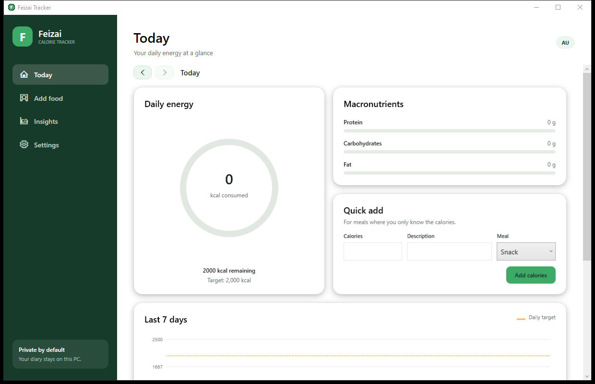

# Feizai Tracker

**A private, local-first Windows calorie tracker made for Australia.**

Feizai Tracker is free and open-source. It includes common Australian foods,
can search packaged products sold by Coles, Woolworths, ALDI and IGA, and keeps
the entire diary on the user's PC.

> 中文简介：这是一个面向澳洲用户的免费 Windows 热量记录软件。内置常见食物，
> 可在线搜索主要超市商品；所有个人记录只保存在本机。



## Features

- Daily calorie target, remaining calories and macronutrient summary
- 111 bundled Australian foods across 11 categories, available offline
- Live Australian packaged-product and barcode search through Open Food Facts
- Retailer filters for Coles, Woolworths, ALDI and IGA
- Adjustable servings in grams or millilitres
- Breakfast, lunch, dinner and snack diary entries
- Quick calorie entry for meals without full nutrition information
- Native 7, 30 and 90-day charts with streak and consistency insights
- Custom foods and CSV history export
- Local JSON storage with no account, telemetry or advertising

## Install

1. Open the [latest release](https://github.com/soeviturek/FeizaiTracker/releases/latest).
2. Download `FeizaiTracker-v*-win-x64.zip`.
3. Extract the zip and run `FeizaiTracker.exe`.

The initial releases are unsigned, so Windows SmartScreen may display an
unrecognised-app warning. Review the source and release checksums before
choosing **More info > Run anyway**.

Online supermarket search needs an internet connection. Everything else works
offline.

## Data and privacy

Diary data is stored at:

```text
%LOCALAPPDATA%\FeizaiTracker\data.json
```

Feizai Tracker has no backend, account system, analytics SDK or cloud sync.
Online searches send only the entered food name/barcode and selected retailer
to Open Food Facts.

The bundled catalogue is a curated, rounded subset based on the FSANZ
Australian Food Composition Database. Packaged-product data is
community-maintained by Open Food Facts and can be incomplete. Always prefer
the current package label. See [THIRD_PARTY_NOTICES.md](THIRD_PARTY_NOTICES.md)
for attribution and data licences.

## Build from source

Requirements:

- Windows 10 or 11
- [.NET 8 SDK](https://dotnet.microsoft.com/download/dotnet/8.0)

```powershell
dotnet restore FeizaiTracker.sln
dotnet test FeizaiTracker.sln -c Release
dotnet run --project src\FeizaiTracker.App
```

Create a self-contained portable release:

```powershell
.\scripts\build-release.ps1 -Version 0.1.0
```

The zip is written to `dist\`.

## Architecture

- **WPF / .NET 8** for a native Windows desktop UI
- **MVVM-style view models** with no third-party UI framework
- **Embedded JSON catalogue** for offline generic foods
- **Open Food Facts API** for Australian supermarket products
- **Atomic local JSON persistence** for the diary, settings and imported foods
- **Custom-drawn WPF charts** with no charting dependency

## Limitations

- This is a general tracking tool, not medical advice.
- Supermarket coverage depends on Open Food Facts contributors.
- Nutrition values and serving estimates vary by recipe and product.
- v0.1 is a portable x64 build and is not code-signed.

## Contributing

Bug reports, food-data corrections and pull requests are welcome. Please read
[CONTRIBUTING.md](CONTRIBUTING.md) first.

Source code is available under the [MIT License](LICENSE). Food data retains
the separate licences listed in [THIRD_PARTY_NOTICES.md](THIRD_PARTY_NOTICES.md).
